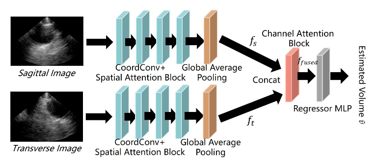

# BladderSense: A Wearable Ultrasound System for Continuous Bladder Monitoring in Real-World Use



[Open the model figure directly](./BladderSense-Model.jpg)

## Overview

This repository contains the source code for **BladderSense**, a wearable ultrasound system for continuous bladder volume monitoring in real-world use. The system processes sagittal and transverse ultrasound images through shared feature extraction branches and estimates bladder volume with an attention-based regression model.

The work appears in the *Proceedings of the 24th ACM International Conference on Mobile Systems, Applications, and Services (MobiSys 2026)*. See the [paper](https://doi.org/10.1145/3745756.3809187) for the full system design, methodology, and evaluation.

## Model Overview

Each ultrasound view is processed by a shared-weight CNN branch using CoordConv and spatial attention blocks, followed by global average pooling. The two view features are concatenated, refined by channel attention, and passed to an MLP regressor to predict bladder volume. The repository also includes ablation variants that remove CoordConv, spatial attention, or channel attention.

## Repository Files

- `main.py`: Command-line entry point for training, evaluation, and benchmarking.
- `model.py`: Model architecture, ablation variants, and parameter/FLOP utilities.
- `data_loader.py`: Paired sagittal/transverse image dataset and preprocessing.
- `train.py`: Training and cross-validation routines.
- `test.py`: Evaluation and single-pair inference helpers.
- `benchmark.py`: Model parameter and runtime benchmarking.

## Requirements

The code uses Python with PyTorch, torchvision, NumPy, Pillow, scikit-learn, and tqdm. Install the packages in an environment that provides your preferred PyTorch build, then install the remaining dependencies:

```bash
pip install torchvision numpy pillow scikit-learn tqdm
```

For optional FLOP counts, install `thop`:

```bash
pip install thop
```

## Data and Usage

The ultrasound dataset and trained checkpoints are not included in this source-code release. Provide an authorized dataset directory containing paired image files named with an `s` or `t` view prefix and their shared volume label, for example `s 99.2.jpg` and `t 99.2.jpg`.

Run a benchmark:

```bash
python main.py --mode bench
```

Train all model variants using 10-fold cross-validation:

```bash
python main.py --mode train_all --data_dir ./dataset --out_dir ./checkpoints
```

The number of folds, epochs, batch size, learning rate, and device can be configured through the command-line arguments shown by:

```bash
python main.py --help
```

## Citation

If you use this project in your research, please cite:

```bibtex
@inproceedings{chen2026bladdersense,
  author = {Chen, Kaixin and
            Toro, Usman Saleh and
            Lin, Jinyu and
            Huang, Chang and
            Xiang, Junfan and
            Wang, Lu and
            Cui, Huachen and
            Zhu, Lei and
            Wu, Kaishun},
  title = {BladderSense: A Wearable Ultrasound System for Continuous
           Bladder Monitoring in Real-World Use},
  booktitle = {Proceedings of the 24th ACM International Conference
               on Mobile Systems, Applications, and Services},
  year = {2026},
  doi = {10.1145/3745756.3809187}
}
```

## Contact

For questions about the implementation, contact Junfan Xiang (Mark Heung) at [heungchunfan@gmail.com](mailto:heungchunfan@gmail.com). GitHub: [markmochi](https://github.com/markmochi).

## License

This project is licensed under the [Creative Commons Attribution 4.0 International License](https://creativecommons.org/licenses/by/4.0/). See [LICENSE.md](LICENSE.md) for details.
